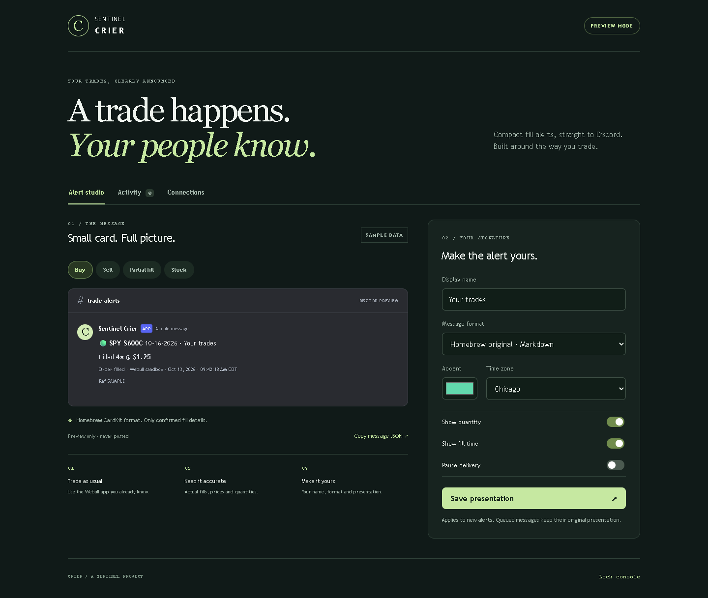

# Sentinel Crier

Free, open-source brokerage fill alerts for the Sentinel family. Trade in your brokerage app; an always-on Crier service turns account events into compact Discord messages. Configure presentation from an iPhone-friendly browser console or a PC browser.

**Status: initial self-hosted release, with an experimental Webull adapter.** Preview and delivery logic are tested with synthetic events. Live Webull manual-app coverage, option payloads and fill-price semantics still require account-specific validation. This is not a native iOS app, a hosted customer platform, or an iPhone screen reader.

## What works

- Homebrew Markdown format adapted from the supplied `AlertBot_CardKit/cards.py`: bold OCC contract headline, `Filled` line, and a compact sell ledger. Full expiration year retained.
- Optional Discord rich card, compact plain text, and restricted Echo BTO entry text.
- Display name, accent for rich cards, quantity/time visibility, time zone and delivery pause controls.
- Stock and unambiguous single-leg OCC option event validation; Decimal arithmetic for cumulative-to-incremental fills.
- SQLite history, audit trail, durable outbox, restart deduplication and sandbox/production separation.
- Discord rate-limit backoff. Ambiguous delivery is held for review rather than blindly reposted.
- Official Webull SDK event observer, initially capture-only. No order placement/cancellation code paths.
- Responsive Safari/Home Screen and desktop browser console. One private installation per user/account connection; no subscription or Tetradim login.

## Quick start: no broker or Discord credentials needed

Python 3.11 or newer. Python 3.11 is recommended for the optional pinned Webull SDK.

```powershell
git clone https://github.com/Tetradim/Sentinel-Crier.git
cd Sentinel-Crier
python -m venv .venv
.venv\Scripts\Activate.ps1
python -m pip install -e ".[test]"
python -m crier serve
```

On macOS/Linux use `source .venv/bin/activate` instead of the PowerShell activation command.

Open **http://127.0.0.1:8765**. On first startup Crier generates a private token in `data/access-token`. Read that file locally and paste the value into the console. The browser holds it only in memory, so refresh/close locks the console. Alternatively configure `CRIER_ACCESS_TOKEN` with at least 32 random characters.

The default is **preview mode**. Buy, sell, partial-fill and stock samples render without changing history or posting messages. API keys and raw brokerage identifiers never appear in a public card. Use **Homebrew original · Markdown** for the supplied kit's visual style; accent color applies to **Discord rich card**.



[View the iPhone-width preview](docs/screenshots/crier-iphone.png).

## Homebrew CardKit relationship

The user supplied a small Tradier watcher and broker-independent formatter. Crier follows that formatter's headline and fill grammar while keeping Webull event ingestion independent. The supplied watcher itself is **not executed or installed**.

For example, a synthetic preview looks like:

```text
🟢 **SPY $600C** 10-16-2026 · Your trades
Filled **4× @ $1.25**
Order filled · Webull sandbox · Oct 13, 2026 · 09:42:18 AM CDT
Ref SAMPLE
```

Unlike the reference kit, this first release emits a separate message for each incremental fill. **Position-level edit-in-place, a running exit/P&L ledger, peak quotes, stops and CLOSED summaries are not implemented.** Accurate versions require verified opening/closing intent, an initial position basis, contract multiplier/adjustment data and position reconciliation. A SELL is not automatically a full close; a BUY is not automatically a new long position. These fields are omitted rather than guessed.

The compact sell table contains execution price and quantity only. The kit's exact rounded-dollar P/L examples are not copied into live output. Full position-ledger behavior is a follow-on feature, not claimed by this release.

## Webull setup

See [Webull validation](docs/webull-validation.md) before enabling any delivery.

```powershell
python -m pip install -e ".[webull]"
```

Configure the environment variables from `.env.example` on the service host. The Python CLI reads the process environment; it does **not** automatically load `.env`. Docker Compose reads the file with `env_file`.

Run `python -m crier watch` in a second process using the same `CRIER_DATA_DIR`. With credentials configured, it records observed events and connection state. It remains capture-only until all three prerequisites are present:

1. A complete verified initial order baseline imported with `python -m crier enroll --baseline data/baseline.json`.
2. `CRIER_WEBULL_VERIFIED=true`, set only after manual-app visibility is confirmed.
3. `CRIER_WEBULL_PRICE_MODE=cumulative_average`, set only after the payload's `filled_price` meaning is checked.

`CRIER_DELIVERY_ENABLED=true` additionally requires a Discord webhook and verified Webull flag. Restart the processes after changing environment variables or enrollment. The observer never uses the Discord webhook; the console process owns delivery. Only run one console sender and one observer per installation.

Individual Webull API access and its sandbox environment are broker-controlled. An unfunded real account can help test authentication/account visibility, but it is not automatically a sandbox and may have no fills to observe. Crier never submits a trade for testing.

## iPhone and PC

For iPhone access, deploy the service on an always-on machine with HTTPS and a persistent `data/` directory, then open it in Safari and use **Share → Add to Home Screen**. The interface is responsive on desktop as well. There is no service-worker cache of credentials or trade history, and no offline-monitoring claim. Closing Safari does not stop a separately hosted service.

The iOS app sandbox prevents ordinary apps from inspecting Webull's private app data, and iOS background scheduling is unsuitable for a permanent account listener. See [Apple's explanation](https://developer.apple.com/forums/thread/685525).

## Deployment

The included Docker Compose example creates a console and an optional observer using a shared persistent volume. Copy `.env.example` to `.env` and fill values locally; never commit credentials.

```sh
docker compose up --build -d
# After configuring and validating Webull:
docker compose --profile observer up --build -d
```

The port is bound to localhost by default. Put a TLS reverse proxy in front for remote access; do not publish the HTTP port directly to the internet. Each installation should have its own volume, token, brokerage credentials and Discord webhook. Data files contain private account evidence: restrict OS permissions and backups. Windows users should use an NTFS ACL/private user directory; POSIX mode bits alone do not establish Windows access control.

## Delivery and recovery

- A webhook is constrained to `https://discord.com/api/webhooks/...`. Mentions are disabled.
- Broker events and generated payloads are stored transactionally before delivery. Broker account/order IDs remain in the local audit database, not the public messages.
- A cumulative fill correction or changed order identity blocks subsequent alerts for that order until reconciled.
- Discord 429 responses defer the entire sender. Definitive 4xx failures stop the job. Network ambiguity or process interruption during sending marks the job `uncertain`.
- Inspect Discord for the card's `Ref` before resolving an uncertain send. No automatic resend is provided for ambiguous jobs.
- Pausing stops delivery, not capture. Resuming sends pending fills with their original timestamps; review accumulated history first.
- Restart reconnects the event listener, but **automatic history backfill is not implemented**. Missed terminal fills may require reconciliation. `export-history` exports one page with its pagination metadata, without replaying anything to Discord.

Operational procedures and remaining limits: [Webull validation](docs/webull-validation.md).

## Echo/Link compatibility

The explicit **Echo entry text · BTO only** template was checked against the local Echo parser with synthetic data. It requires verified option BUY/OPEN intent. The current Webull mapping leaves intent UNKNOWN, so it holds such a job for review instead of inventing BTO. Webull orders continue to work as informational Homebrew/rich/plain alerts.

Echo exits, copied sizing, position matching and execution have not been verified. Route informational alerts to a channel that Echo does not execute. Do not assume a card's visual appearance is an execution contract.

```powershell
python scripts/check_echo.py C:/path/to/Sentinel-Echo/backend
```

## Development

```sh
python -m pip install -e ".[test,webull]"
python -m pytest -q
python -m compileall -q crier
node --check crier/static/app.js
```

Tests use temporary databases and fake Discord responses; they do not connect to a live brokerage or post to Discord. The UI was exercised at 390px and 1440px widths in Chromium; actual iOS Safari and App Store distribution have not been tested.

To repeat the browser check, install Playwright (`python -m pip install playwright`), install Google Chrome, start Crier on port 8765, then run `python scripts/check_ui.py`. This script uses the locally generated token and synthetic previews, saves screenshots under ignored `data/ui-check`, and resets presentation to the default Homebrew format.

See the [design](docs/superpowers/specs/2026-10-13-crier-design.md) and [implementation plan](docs/superpowers/plans/2026-10-13-crier-implementation.md). Other brokers can map into the canonical `Snapshot` boundary; only Webull is wired today. Tradier is a useful next adapter, but the supplied kit is not advertised as integrated.

MIT license. Part of [Tetradim's Sentinel projects](https://github.com/Tetradim).
