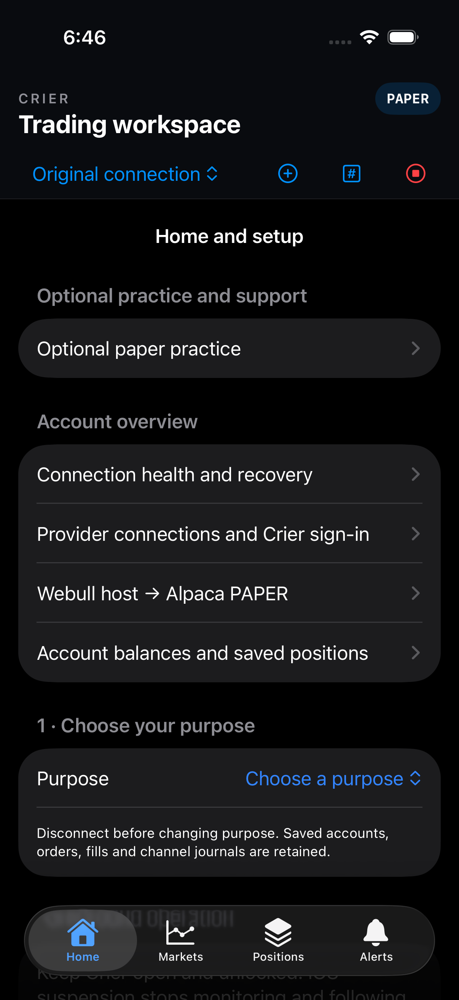
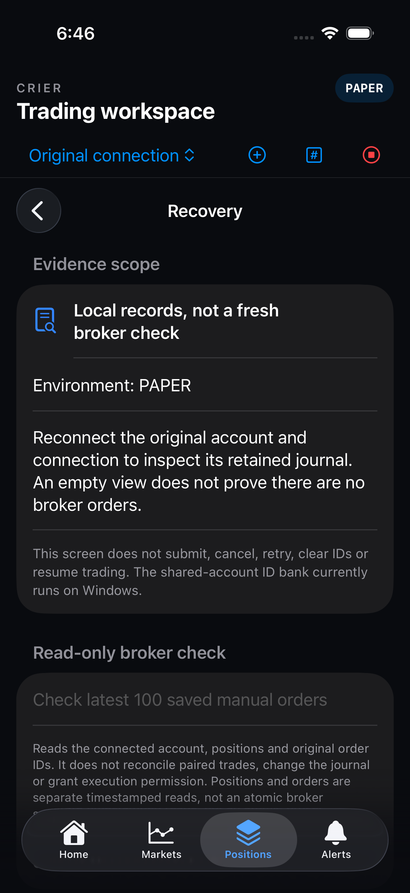

# Sentinel Crier

**Trade, share and follow stock or option orders across iPhone, Android and Windows—with optional Discord alerts.**

Crier is free, open-source software for privately paired trading communities. A host enters orders inside Crier; receivers follow through their own accounts with their own allocation and execution controls. Discord is optional and is not the copy-trading transport.

The active native brokerage integration is **Alpaca**, supporting paper/live accounts, whole-share stocks and standard long single-leg options. Webull is a separate candidate workflow; provider activation and real acceptance are deferred.

## Download 0.5.0

| Platform | Get started |
| --- | --- |
| Windows | [Installer](https://github.com/Tetradim/Sentinel-Crier/releases/download/v0.5.0/SentinelCrier-0.5.0-Windows-Setup.exe) · [Portable ZIP](https://github.com/Tetradim/Sentinel-Crier/releases/download/v0.5.0/SentinelCrier-0.5.0-Windows.zip) · [Setup](desktop/README.md) |
| Android | [Signed APK](https://github.com/Tetradim/Sentinel-Crier/releases/download/v0.5.0/app-release.apk) · [Setup](android/README.md) |
| iPhone | [Build guide](ios/BUILD.md) · [Distribution checklist](docs/iphone-release-checklist.md). Apple signing/TestFlight is owner-deferred; no signed iPhone download is published. |

[All release assets, checksums and manifests](https://github.com/Tetradim/Sentinel-Crier/releases/tag/v0.5.0)

Windows includes startup update notices, manual update checks and private recovery snapshots. Installation remains explicit. Its installer is Authenticode-unsigned; the update catalog is Ed25519-signed. Android packages use the operator's signing identity. See [updates and recovery](docs/customer-updates.md).

## Choose your workflow

| Workflow | Behavior |
| --- | --- |
| Alerts only | Monitor supported fills and publish configurable Discord alerts without enabling trading. |
| Trade | Enter and manage supported orders inside Crier. |
| Host | Share entry, replacement, cancellation and exit instructions with paired receivers. |
| Receive | Follow a selected host using your own account, sizing, pricing and exit settings. |

### Connect two devices

1. Install or build Crier on both devices and connect each device's own brokerage account. Choose paper or live deliberately.
2. On the host, create a private invitation. On the receiver, accept it.
3. Review the receiver's pricing, size, exit and allocation settings. New entries start paused.
4. Explicitly enable the receiver. Orders placed inside the host's Crier app publish instructions without waiting for the host's fill.
5. Inspect orders, fills and device results in the Copy dashboard.

Devices may use different networks. The bundled [Supabase testing relay](crier/connection-service.json) supplies the shared endpoint; customers do not need a home server, router port forwarding or their own Supabase project. Authenticated push carries durable instructions, with polling as recovery.

Current Alpaca credentials remain on the executing device in protected storage. The relay transports instructions and observations, which its operator can see; it does not execute Alpaca orders.

[Pairing and copying](docs/intent-mirroring.md) · [Push and dashboard](docs/push-dashboard.md)

## Multiple hosts and allocations

Windows, iOS and Android retain independent host/account connections. To let several hosts share one Alpaca destination **within one receiving installation**, explicitly enable the **Account ID bank**.

- Persistent numeric trade IDs, separate host ownership and distinct client-order IDs.
- Separate stock/option pools per host in units, dollars or percentage of destination equity.
- One shared cash ledger; options buying power additionally limits option buys.
- Reservations before submission, retained across timeouts, restarts and partial fills.
- Exits restricted to the issuing host's owned, unreserved units.
- Automatic archiving of completed empty IDs, preserving history and duplicate protection.

Setup drains workers and requires older Crier orders and holdings to be reconciled and closed. New pools default to zero. Pools are aggregate exposure ceilings; per-entry sizing is separate. Managed shared-account execution requires limit pricing. Zero future allocation does not remove ownership or exit authority.

[Account-bank setup](docs/account-id-bank.md) · [Multiple connections](docs/multiple-connections.md) · [Execution settings](docs/execution-policies.md)

## Recovery and diagnostics

Recovery explains unknown outcomes and inventory discrepancies using retained IDs and broker evidence. Account-bank checks include original terminal/archived orders and preserve ownership when late fills arrive.

**Verified-flat repair** rechecks original orders, inventory and fresh funds before rebuilding local accounting. It refuses unresolved orders, open holdings or conflicting evidence, records an audit event, retains IDs/history and leaves entries paused. It never blindly resubmits an order or reassigns external holdings.

iOS also has a separate read-only check for saved manual orders. Execution diagnostics provide timelines, quantities, eligible premium/latency comparisons and JSON/CSV exports. Missing evidence is not replaced with invented prices or timing.

[Recovery guide](docs/recovery-assistant.md) · [Execution diagnostics](docs/execution-diagnostics.md) · [Windows unattended diagnostics](docs/unattended-diagnostics.md)

## Discord publishing

Choose Alerts only, configure a destination, review its preview and explicitly enable delivery. Layouts include cards and plain text; iOS and Python also provide Homebrew-style formatting. Available fields include symbol, side, quantity, price, time and provenance.

Publishing permission is separate from trading permission and must be renewed after reconnect. Inspect uncertain deliveries before retrying because the earlier post may have succeeded.

[Monitor/publisher guide](docs/monitor-publisher.md)

## Screenshots and verification

Actual iOS simulator captures, disconnected in paper mode:




Version 0.5.0 acceptance recorded **1,291 Python/Tk tests passed, one skipped; 196 iOS native tests passed; 187 Android unit tests passed**, plus simulator/emulator UI and Windows installer checks. Published hashes, Android signatures, the update-catalog signature and update discovery were verified.

[Acceptance report and screenshot gallery](docs/acceptance/2026-11-01/account-bank/README.md)

## Scope and deferred work

Crier does not continuously watch another iPhone app's screen or detect its button presses. Submission-time mirroring applies to orders entered inside Crier; supported external-account fill monitoring is a different workflow. iOS requires foreground operation. Android/Windows operation remains subject to lifecycle and connectivity.

Native execution is Alpaca-based. Tradier has a read-only Python observer; the Webull candidate is not an activated trading adapter. Shared-account banks coordinate routes on one receiving installation, not several installations using the same account. Independent strategies, trailing stops, automatic market fallback and arbitrary cross-broker execution remain future scope.

Apple enrollment/signing, physical-device/broker acceptance and Webull/provider activation are [owner-deferred](docs/deferred/2026-10-31-owner-provider-acceptance.md). Automated acceptance does not establish identical fill prices, guaranteed latency or profitable copying.

[Broker/provider status](docs/remaining-work.md) · [Future scope](docs/future-scope.md)

## Run from source

Python 3.11+:

```powershell
git clone https://github.com/Tetradim/Sentinel-Crier.git
cd Sentinel-Crier
python -m venv .venv
.venv\Scripts\Activate.ps1
python -m pip install -e ".[test,desktop]"
python -m crier.desktop
```

For the separate local web console, run `python -m crier serve`. Open `http://127.0.0.1:8765` using the generated private token in `data/access-token`. Default startup selects no broker and leaves delivery disabled. On macOS/Linux, activate with `source .venv/bin/activate`; the desktop app targets Windows.

Run Python tests with `python -m pytest -q`. Native build instructions are in [iOS](ios/BUILD.md) and [Android](android/README.md). Keep broker credentials in protected app configuration, never Git.

## License and support

[MIT License](LICENSE) · [Report an issue](https://github.com/Tetradim/Sentinel-Crier/issues)

Include the version, platform, paper/live environment and sanitized diagnostics in support reports. Keep brokerage keys, webhook URLs, pairing tokens and raw recovery backups private.
