# Recovery fixes and brokerage workspace acceptance

Final source: `bf5bc28c78ed679ab8eba8f52430ec54ad556653`, based on reviewed `660e864`. The core fixes/refactor are `415d3bd`; Android safe areas are `d635604`, corrected mobile recovery guidance is `7cb296c`, dark theme/contrast is `a268ba3`, and dedicated Android Trade/keyboard acceptance is `bf5bc28`.

## Correctness

- Windows bank dialogs retain their original route and refuse saves after selection changes. Automatic and pasted provider callbacks resolve to the unique pending originating flow.
- Recovery and flat repair pause every route sharing the account before awaiting lifecycle locks. Concurrent enable attempts are refused, and success, failure or cancellation leaves entries paused.
- iOS manual evidence preserves immutable broker identity, monotonic fills, terminal progression and positive fill-price proof before atomic journal replacement. Broker-backed manual bank admission uses the same validator. Valid later fills remain admissible.
- iOS host entries require a deliberate command in the current session. Reconnect and bank transitions revoke old entry permission; follower resume preferences cannot authorize a queued host entry.
- Android reconciles a durable bank-proven refusal into a local terminal disposition only when the original route owns an unfilled, broker-ID-free superseded record. Ambiguous POSTs remain blocked.
- Android bank observations execute off the UI thread and discard results after lifecycle/account changes. Pool editing provides worker-stop guidance and rechecks the transition guard before saving.

Independent cross-platform source reviews found and corrected the manual Windows callback gap. Additional regressions cover cancellation while waiting for lifecycle ownership and retained economic evidence.

## Module changes

Line counts use Git-normalized source, excluding build output. The new modules retain validated journal commits, lifecycle fencing and atomic bank transactions.

| Original file | Before | After | Extracted responsibilities |
| --- | ---: | ---: | --- |
| `crier/desktop.py` | 1473 | 1348 | Route-bound bank dialogs, trading navigation, provider form |
| `crier/desktop_runtime.py` | 630 | 529 | Verified provider grant installation, broker discovery/read adapter |
| `ios/SentinelCrier/IntentMirroring.swift` | 1311 | 500 | Models, execution, relay HTTP, telemetry projection, host permission |
| `ios/SentinelCrier/AlpacaWorkspace.swift` | 813 | 658 | Bank admission, connection form, ticket presentation |
| `ios/SentinelCrier/CrierCommandCenter.swift` | 399 | 86 | Account, orders, positions, recovery, alerts and setup screens |
| Android `MainActivity.kt` | 436 | 423 | Navigation, bank dialogs, reviewed host ticket, scoped observations |
| Android `Journal.kt` | 125 | 112 | Alert outbox transaction and event validation |
| Android `Engine.kt` | 196 | 151 | Order reconciliation and broker observation validation |

The remaining financial ledger/journal implementations were kept cohesive. Moving lines without reducing the caller's required knowledge would not improve their safety or maintainability.

## UI decisions

The [implementation plan](../../../superpowers/plans/2026-11-01-review-refactor-mobile-ui.md) records official Webull navigation references. iOS now has permanent Home, Markets, Trade/Follow, Positions and Orders tabs. The account overview uses loaded broker balances with snapshot time and a balance-privacy control. Setup, fill alerts and recovery remain reachable from the account area. The account selector, paper/live state, bank and emergency stop stay visible.

Android adds account/environment context, Home/Trade/Positions/Account navigation, a persistent Stop control, retained-position observations and a reviewed exact source instruction. The ticket has its own container rather than relying on a scroll into setup. Windows separates Order, Positions and Activity while retaining native table and ticket scrolling. Missing market/broker data is explicitly unavailable.

Actual acceptance caught and corrected Android 15 system-bar clipping, unreadable selector text and a selected Trade tab showing setup content. Native checks now require visible ticket content, single-line navigation, 48dp targets, readable selectors, and reachable navigation/Stop with the software keyboard open. iOS screenshot review also removed stale Windows-only account-bank guidance.

## Verification

- Local full Python/Tk suite: **1301 passed, 1 skipped** (153.69 seconds).
- Independent focused Windows regression suite: **233 passed**.
- Fresh local Android production/unit compilation against SDK 35 and JUnit: **190 passed**.
- Native iOS trading tests: **199 passed**; simulator and unsigned iPhone archive compilation passed.
- Android emulator acceptance: **12 passed**, including keyboard-open and held-bank-lock cases; iOS customer UI journeys passed.
- Strict UTF-8 validation of all changed source/documentation files and staged whitespace validation passed.

[Machine-readable source, test, artifact-hash and screenshot evidence](verification.json).

| Evidence | Run |
| --- | --- |
| Windows tests and portable build | [41339377029](https://github.com/Tetradim/Sentinel-Crier/actions/runs/41339377029) |
| Windows installer lifecycle and signed update catalog | [41339416463](https://github.com/Tetradim/Sentinel-Crier/actions/runs/41339416463) |
| iOS simulator/device archive | [41364858312](https://github.com/Tetradim/Sentinel-Crier/actions/runs/41364858312) |
| Final iOS native trading tests | [41366203243](https://github.com/Tetradim/Sentinel-Crier/actions/runs/41366203243) |
| Final iOS customer UI and six captures | [41366203240 / iOS job](https://github.com/Tetradim/Sentinel-Crier/actions/runs/41366203240/job/125026777887) |
| Final Android emulator customer acceptance | [41366203240 / Android job](https://github.com/Tetradim/Sentinel-Crier/actions/runs/41366203240/job/125026777552) |
| Final Android signed package | [41366268389](https://github.com/Tetradim/Sentinel-Crier/actions/runs/41366268389) |

## Screenshots

Installed native apps, disconnected. iOS uses paper mode; Android has no connected account. The keyboard capture types the test ticker SPY without submitting an instruction or loading a quote.

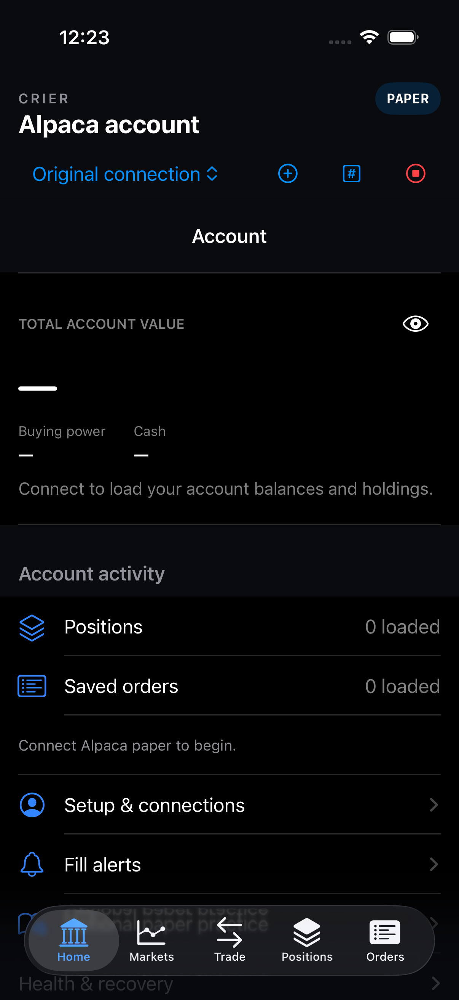
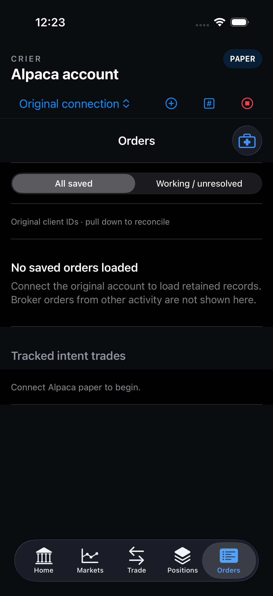
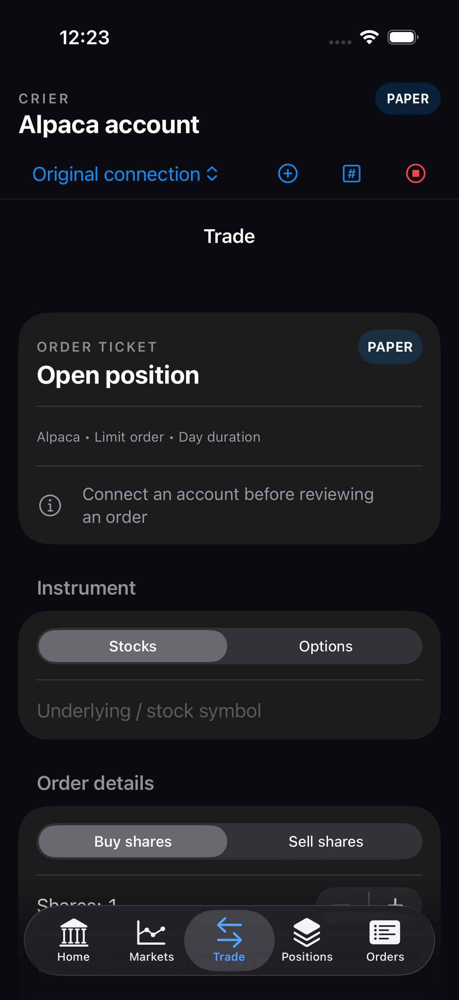
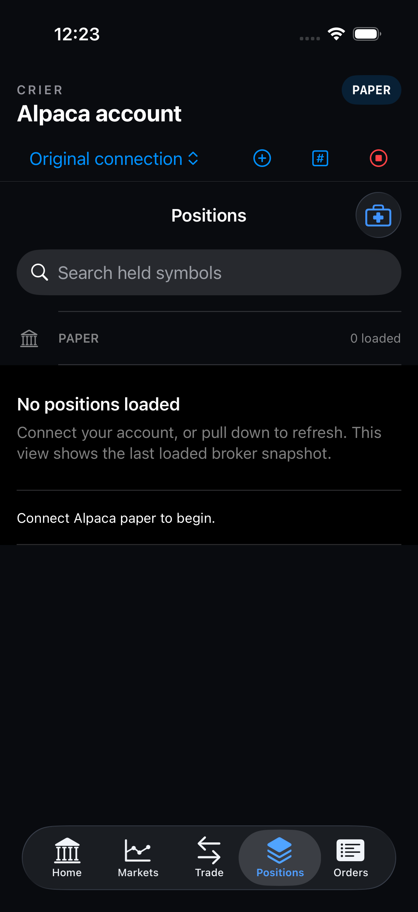
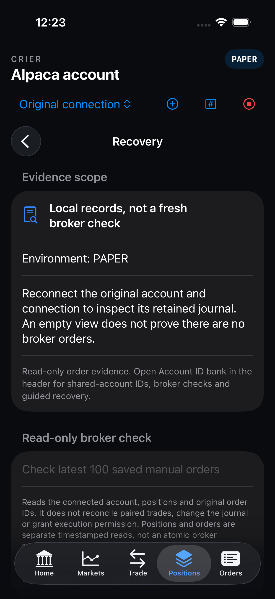
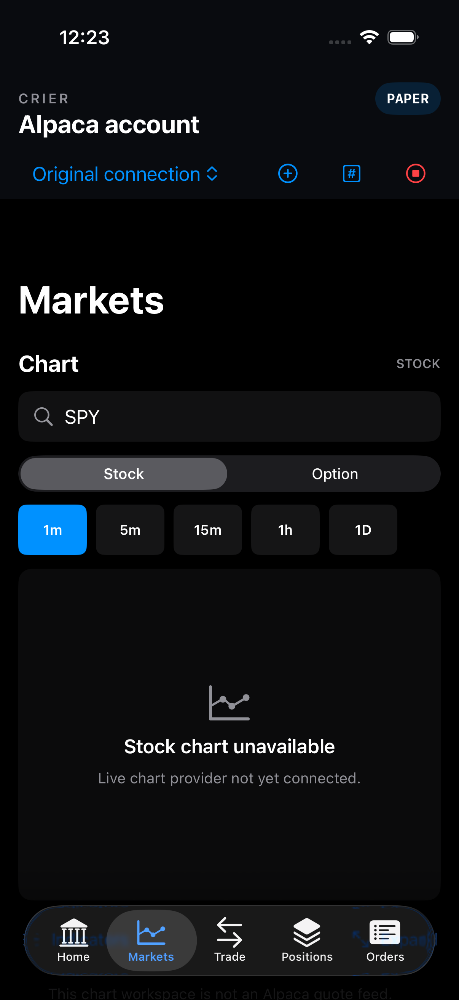
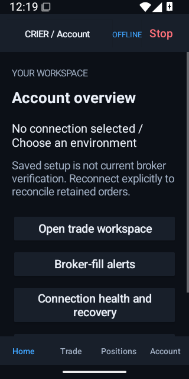
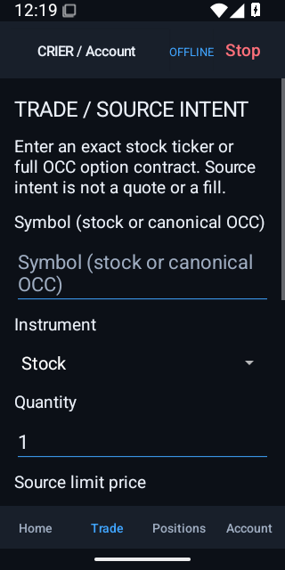
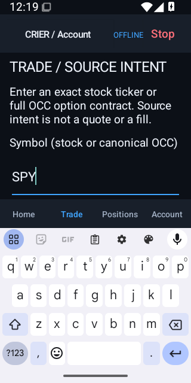
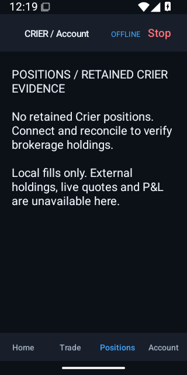
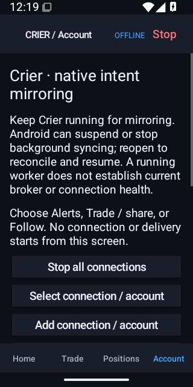

## Release provenance

Windows is built from `415d3bd`; its runtime/build/version paths are unchanged through `bf5bc28`. Android is built from `bf5bc28` with version code 7, previous code 6, and the existing operator certificate. Final iOS captures/tests use `bf5bc28`; unsigned hardware archive compilation uses `7cb296c`, whose iOS source tree is unchanged through `bf5bc28`. Git path comparisons verify these relationships, and each package manifest retains its actual as-built commit.

All installer/portable/APK/AAB hashes and the trusted Ed25519 update-catalog signature were verified locally. APK and AAB signature verification passed; the Android signing identity is operator-provided/self-signed. The Windows installer remains Authenticode-unsigned. Installer acceptance used isolated GitHub-hosted state and verifies install, an acceptance-only next-patch upgrade, downgrade rejection, retained journals/credentials and startup preference. It does not establish physical-machine acceptance or a future migration.

[External review assessment and additional proposed follow-ups](../../../reviews/2026-11-01-external-fixed-review.md). New recommendations are separate from this approved recovery/refactor/UI scope.

## Unchanged owner deferrals

[Physical-device/provider acceptance and Apple distribution](../../../deferred/2026-10-31-owner-provider-acceptance.md) remain explicitly owner-deferred. No automated result establishes real cross-network latency, Webull execution, broker UI agreement or physical iPhone lifecycle behavior. The verification uses isolated local state and synthetic accounts; it places no real broker orders and sends no customer/Discord notifications.
