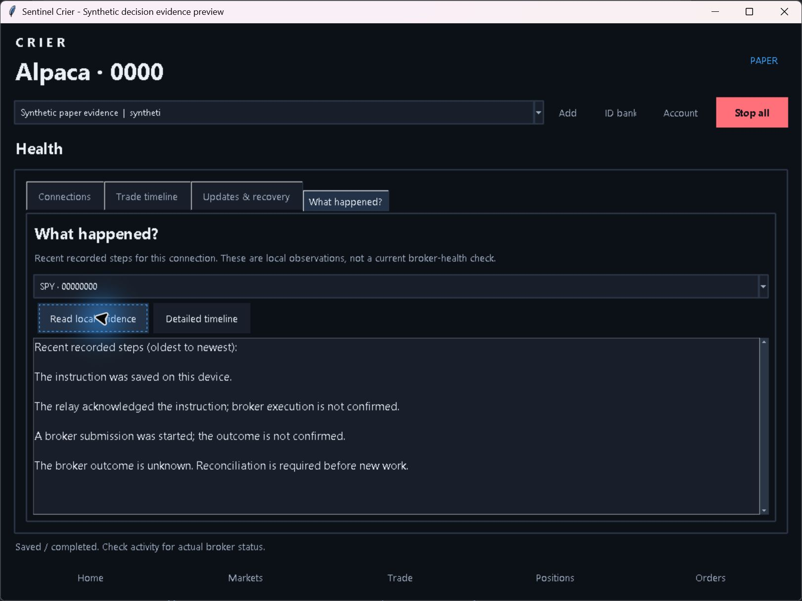

# Review improvements — Crier 0.5.3

The approved work was implemented in order: shared native scenarios, journey coordinators, selected diagnostic logging, then plain-language explanations.

## Implemented scope

- Seven [shared native invariant scenarios](../../../protocol/native-invariants.md) exercise real bank/clock implementations, including late cumulative fills and durable refusal of decreasing proof. Exact API/storage/lifecycle differences are documented; this is not a claim of whole-engine parity.
- DesktopJourneys separates navigation, setup and connect callbacks while retaining DesktopApp entry points and app-owned route/Stop/action-epoch fences. Android JourneyCoordinator separates purpose/route transition ordering and retains the original process-owned writers, OAuth inbox and lifecycle owners. These are focused extractions, not complete removal of every large UI/controller file.
- Optional trace/queue/clock/transport failures record fixed sanitized codes through the existing bounded logger. Failed logging remains nonfatal. Expected wait timeouts stay quiet; retry exhaustion remains thirty attempts.
- [What happened explanations](../../../decision-explanations.md) read existing records on Windows, Android and iOS. Seventy-seven shared explanation examples cover known/unknown stages, partial/terminal status, cancellation distinction, chronology and privacy. Windows clears summaries and advanced timeline text on selection/route changes and rejects late results. No permission or execution path is added.

## Local verification

- Full Python/Tk suite before the final advanced-timeline isolation fix: **1,437 passed, one optional test skipped** in 189.18 seconds. Final isolation fix and regression: **44 relevant checks passed**.
- Full Android production/test compilation against SDK35: **200 JUnit tests passed**, including the real plain-enum journal adapter regression. The existing decor-fits-system-windows deprecation warning remains.
- Independent review prompted cumulative-fill correction coverage, retry-exhaustion coverage and the Android reason-enum adapter fix. Each was verified. A moved desktop import was corrected during the coordinator self-review.
- `git diff --check` passed before source commit. Hosted checks, package acceptance and public update verification passed as recorded below.

Synthetic tests use no real brokerage orders, customer notifications or provider credentials. Apple signing, physical/provider acceptance and Webull activation remain owner-deferred.

## Final verification and published packages

[Windows installer/ZIP and signed Android APK/AAB](https://github.com/Tetradim/Sentinel-Crier/releases/tag/v0.5.3) · [Structured verification](verification.json).

Release/test source: `3800611a38083523f20fb8819060c31832e55333`. Windows and Android package runtime source: `43106db797aa40ce50927c113ea9c84153f51206`. The later commit changes only benchmark tests; Git verified identical Windows, Android, iOS, release-metadata and Python runtime inputs. The publication workflow independently checks source equivalence, candidate provenance, hashes, signatures and the exact nine-asset release before publication.

| Check | Result | Evidence |
| --- | --- | --- |
| Final Windows Python/Tk suite and packaged smoke test | 1,439 passed; one optional SDK test skipped | [Windows desktop](https://github.com/Tetradim/Sentinel-Crier/actions/runs/41542274080) |
| Native iOS safety tests | 203 passed | [Safety workflow](https://github.com/Tetradim/Sentinel-Crier/actions/runs/41542273251) |
| Android production compilation/unit tests | 200 JUnit tests passed locally; hosted build and signed packaging passed | [Android build](https://github.com/Tetradim/Sentinel-Crier/actions/runs/41540263535) · [Signed packaging](https://github.com/Tetradim/Sentinel-Crier/actions/runs/41540284040) |
| Windows journeys and Android/iOS UI acceptance | All jobs passed | [Customer acceptance](https://github.com/Tetradim/Sentinel-Crier/actions/runs/41542450545) |
| Provider preparation on Windows and Python 3.11/3.12 Linux | All jobs passed; Windows 1,439 passed/one skipped | [Provider checks](https://github.com/Tetradim/Sentinel-Crier/actions/runs/41542449851) |
| Windows installer and signed update catalog | Accepted on ephemeral runner | [Release candidate](https://github.com/Tetradim/Sentinel-Crier/actions/runs/41540283650) |
| Complete accepted artifact publication | Nine public assets verified | [Publication](https://github.com/Tetradim/Sentinel-Crier/actions/runs/41544023311) |

The public installer, ZIP, APK, AAB and metadata match their accepted candidate bytes. The update catalog verifies against Crier's bundled Ed25519 key. The actual 0.5.2 updater discovers, downloads and verifies 0.5.3. No installer was executed on the owner's PC. Android APK verification independently confirms the existing operator certificate `1FF6C2BC5857D0DE21B5FB286E11DEA8F5A85E3B4B92CBBA3E94186B89B1C2A6`; the AAB JAR signature verifies as well. Android's previous public package was 0.5.1/code 7; code 8 was reserved by the intervening source version, and 0.5.3 uses code 9.

Installer acceptance checks fresh installation, an acceptance-only next-patch upgrade, downgrade rejection, synthetic DPAPI/journal retention and uninstall preservation on an ephemeral Windows runner. It is not customer-machine or future migration acceptance. Windows remains Authenticode-unsigned; the update catalog is signed. iOS source/build/tests are updated, while signed iPhone distribution remains owner-deferred.

## Benchmark test correction

The [initial provider Windows run](https://github.com/Tetradim/Sentinel-Crier/actions/runs/41540262939) delivered all sixteen expected relay events but failed its rate-gate assertion. A slow sequential probe can legitimately cross multiple minute windows, so forty-one requests do not guarantee reaching the production threshold in any one window. A controlled-clock regression reproduces that reset behavior. Only the integration test's pairing-module clock is frozen for gate validation; delivery timestamps and latency clocks remain real. All original delivery, authentication, malformed-input and 429 assertions remain. Production rate limiting is unchanged. Sixteen focused tests and the final full/provider runs passed after the test-only correction.

## Actual UI screenshot

This is the real Tk application, using an isolated fake worker and explicitly labeled synthetic retained evidence. It demonstrates rendering and read/navigation behavior, not real broker fills or physical/customer acceptance.

