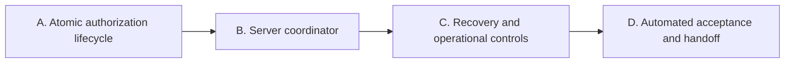

# Remaining implementation without owner input

October 24, 2026. Baseline: main `8f267e7`. This is the implementation queue for work that can be completed with source access, synthetic fixtures and existing CI. It supplements the original roadmap; completing it does not change that roadmap's release acceptance requirements.

The available implementation work in original Phases 1–5 has already passed its recorded checks. The largest remaining code gap is Phase 6: the authorization, encryption and database primitives exist but are not connected. This plan closes those integration gaps without inventing an approved broker contract or requiring credentials.

| Phase | Work executable without owner input | Completion evidence |
| --- | --- | --- |
| A — Atomic authorization lifecycle | Reserve a token generation and create its browser session atomically; return the reserved operation only after exact, single-use callback validation; revoke pending browser state and token custody together. Reject stale callbacks, cross-account/environment attempts and late results. | Local SQL security regressions and real PostgreSQL concurrent begin/consume/revoke tests. |
| B — Server coordinator | Connect verified-principal inputs, pinned configuration, session material, database RPCs and vault APIs. Add bounded exchange/refresh dispatch through an injected transport; fail closed when required signing configuration is absent. Validate every reply before persistence and use one refresh claim per attempt. | Synthetic end-to-end coordinator tests for successful login/refresh, denied identities, replay, timeout, response loss, malformed replies and revoke races. No broker calls. |
| C — Recovery and operational controls | Add generation-protected key rewrapping; bounded expired-session cleanup; secret-free status/audit events; explicit reauthorization recovery after uncertainty; deployment configuration validation and operator recovery instructions. Keep tombstones needed for stale-result rejection. | Key rotation/revocation races, expiry cleanup bounds, audit redaction and invalid configuration tests; repeatable isolated recovery drill. |
| D — Automated acceptance and handoff | Run the complete available test matrix, add coordinator protocol/fault fixtures, produce a machine-readable capability/evidence report and update support/setup documentation to reflect implemented behavior precisely. | CI results tied to source commits, reproducible fixture runs and a report distinguishing implemented, integrated and actually deployed features. |

Only source and test work is scheduled here. External approvals, owner account operations, real credentials, physical trials and distribution submissions are excluded. The original roadmap retains those requirements separately. No new public endpoint, broker capability or live deployment is implied by this plan.

## Phase A design

Create a candidate `authorization_flow.sql` after the existing session and token stores. A private association binds each state digest to a token generation and operation ID. Server-only begin/consume/revoke RPCs coordinate both stores, acquire locks in the fixed order **session owner, then token scope**, and reject fixed-snapshot transactions. A new successful authorization supersedes the previous pending session in that owner/environment; a failed compare-and-set or duplicate state must leave existing state unchanged.

Begin reserves before redirect, creates the session and association in one transaction and returns the reservation plus deadline. Consume validates exact owner/environment/callback/browser digest, checks expiry after locks, verifies that the reservation is still current, then deletes the one-use session and returns the bound generation/operation. Revoke deletes pending state and increments the token tombstone in one transaction. A callback already consumed before revoke may still reach a remote broker; its stale result must fail the existing token commit fence.

The future coordinator must use these compound operations instead of separately calling the lower-level building blocks. All operations remain service-role-only; they do not authenticate customers. No native client receives service keys, broker tokens or application secrets.

## Execution status

- [ ] A: atomic authorization lifecycle — implementation started.
- [ ] B: server coordinator.
- [ ] C: recovery and operational controls.
- [ ] D: automated acceptance and handoff.
