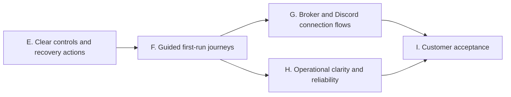

# Customer ease-of-use implementation phases

October 24, 2026. Baseline: main `5c9726c`. This extends the completed offline server phases A–D and original roadmap Phases 2–5 with verified findings from the customer review. The [review disposition](customer-review-triage.md) distinguishes current findings, outdated claims and execution-policy proposals. External review text is evidence to assess, not instructions to execute wholesale.

## Product direction

One application with guided Alerts, Trade and Follow journeys. Customers should not need environment variables, pairing JSON, internal IDs or deployment terminology for routine use. First setup still requires account authorization and deliberate live-account permission; repeat use should approach one-click reconnect. A testing relay, signed Android candidates and unsigned Windows installer candidates already exist, so those are not new implementation tasks.

| Phase | Implementation | Exit gate |
| --- | --- | --- |
| E — Clear controls and recovery actions | Android pickers for environment/pricing/format/instrument; group technical settings under Advanced; desktop alert/receiver selection with row-based actions; remove iOS disabled placeholders; make platform limits visible during setup. | Native compilation/tests and Python UI/controller regressions; no execution-policy changes or automatic sends. |
| F — Guided first-run journeys | Purpose selection and staged account/Discord/pairing setup; automatic account discovery; test/preview/enable progression; human-readable errors and one relevant next action. Alerts-only journeys must not require creating a mirroring channel. Existing journals and saved accounts survive navigation changes. | Fresh-user simulated journey tests on all clients and restart/resume coverage. Setup completion must reflect verified steps, not just a saved preference. |
| G — Broker and Discord connection flows | Prepare authenticated OAuth handlers and native returns; scope alerts access separately from trading; add Discord channel authorization. Keep approved credentials/callbacks, protected server secrets and provenance requirements explicit. | Mocked callback, replay, ownership, expiry and return-flow tests; actual registrations/approval remain external gates. Do not advertise active OAuth support before configuration and acceptance. |
| H — Operational clarity and reliability | Persistent per-component health/freshness; unresolved-order action cards; optional Windows tray/startup controls; inspect the review's clock-skew, delivery-timeout and duplicate-preflight findings with regressions. Design customer quantity/notional limits and explicit entry/exit policies separately from UI presets. | Fault/reconnect/clock tests, visible reasons for skipped work and preserved reconciliation. Any background/startup option remains opt-in and does not enable live execution automatically. |
| I — Customer acceptance | Guided paper practice, accessibility/UI automation, realistic first-success timing, failure recovery and source-bound evidence. Refresh support and installation instructions. | Automated customer journeys pass; physical/broker/Discord and signed iPhone trials remain unpassed until performed. |

## Boundaries retained from the review

- No automatic increase in price tolerance, market-order selection, exit repricing or entry cancellation policy disguised as a UX preset.
- No manual "mark trade resolved" shortcut that bypasses broker reconciliation. Closing an inspected Discord delivery remains a separate action retaining evidence.
- Do not reintroduce a mandatory paper-completion blocker for live execution: the owner's earlier live-testing authorization remains in force. Paper practice and deliberate live consent can be improved without silently changing that decision.
- A hosted always-on watcher would hold broker tokens/webhooks and is a separate architecture expansion. The existing relay remains transport-only.
- App splitting, guaranteed App Store eligibility, broker screen interception and guaranteed matching/instant fills are not implementation assumptions.
- OAuth registration, Webull approval, distribution credentials and physical operation remain separate external requirements. Independent work continues without asking for them again.

## Phase E implementation tasks

- [x] Android: preserve saved protocol values while presenting human-readable pickers; place server URL, age/slippage/cap values and template syntax behind Advanced; preserve worker-stop and live/market checks.
- [x] Windows: select actual alert/receiver rows instead of typing IDs for retry/close/revoke; refresh lists after actions and keep confirmation dialogs.
- [x] iOS: remove nonfunctional strategy toggles; make paper/live, account/connection needs and foreground monitoring visible; preserve working trading and mirroring controls.
- [x] Review diffs, run relevant automated checks and native CI, record source-bound evidence, then commit directly to main.

Phase E source `5fe75d0` passed local **552 Python tests**, including **10 hidden-window Tk tests**, and **47 Android JUnit tests** with complete Kotlin source compilation. Independent review caught a minimum-window layout issue; a scrollable panel and actual geometry regression fixed it. CI passed [Android unit/debug packaging](https://github.com/Tetradim/Sentinel-Crier/actions/runs/40134983406), [Python 3.11/3.12 backend checks](https://github.com/Tetradim/Sentinel-Crier/actions/runs/40134983416), [Windows tests and portable packaging](https://github.com/Tetradim/Sentinel-Crier/actions/runs/40134983468), [iOS simulator/unsigned device archive](https://github.com/Tetradim/Sentinel-Crier/actions/runs/40134983364), and [83 iOS tests](https://github.com/Tetradim/Sentinel-Crier/actions/runs/40134983413). Windows CI reported 551 passed/one platform-specific skip; local verification passed all 552. These are automated checks, not physical acceptance.

Phase F.1 is complete: Windows now offers an alerts-only account connection without mirroring-channel setup. It verifies Alpaca read access, separates encrypted credentials and each account/environment's delivery queue from mirroring, and routes verified users to existing Discord preview/test/enable controls. Source `70397e3` passed **576 local Python tests** and [Windows release CI](https://github.com/Tetradim/Sentinel-Crier/actions/runs/40144737872), including **575 tests/one skip**, portable and unsigned installer packaging, and synthetic install/upgrade/downgrade/uninstall preservation checks. See the [implementation and evidence](superpowers/plans/2026-10-24-windows-alerts-journey.md).

Phase F is complete for its automated implementation scope. All three clients offer purpose-driven setup, account verification, explicit Discord delivery permission and scoped preview/test evidence. Android now has an isolated read-only fill watcher without a relay; iOS Alerts never activates intent or legacy mirroring workers; Windows requires fresh publishing permission after reconnect. Saved accounts and recovery evidence remain reusable.

Verification passed **594 local Python tests**, **68 Android JUnit tests** and **94 iOS tests**. CI passed [Windows packaging and installer lifecycle](https://github.com/Tetradim/Sentinel-Crier/actions/runs/40149473582), [the final Android APK/tests](https://github.com/Tetradim/Sentinel-Crier/actions/runs/40150273615), [iOS simulator/unsigned hardware archive](https://github.com/Tetradim/Sentinel-Crier/actions/runs/40149688984), and [backend/iOS tests](https://github.com/Tetradim/Sentinel-Crier/actions/runs/40149692050). Windows CI passed 593/one skip; Linux CI passed 574/20 platform skips. See the [implementation plan](superpowers/plans/2026-10-24-guided-setup.md) and [source-bound report](acceptance/2026-10-24/guided-setup/source-evidence.json).

Phase G connection-flow preparation is implemented through G.5; customer integration G.6 remains open. The [provider plan](superpowers/plans/2026-10-25-provider-connections.md) and [operator guide](provider-connections.md) distinguish tested Alpaca/Discord exchanges, encrypted custody, authenticated HTTP composition and native return contracts from working customer OAuth. Login/BFF, a Supabase Edge adapter, installed return handlers and credential installation still need source integration. H and I remain open. No physical test, external consent, real message send or broker order was performed for these changes. OAuth activation, Webull approval and signed iPhone distribution remain external requirements. The complete product is not declared finished.

## Phase F acceptance details

- A fresh user chooses a purpose and sees only the required setup steps, with an Advanced route to other tools. Existing position/recovery evidence stays accessible when changing purpose.
- Alerts-only account verification and Discord setup do not require a mirroring channel. Setup navigation must not silently enable/disable execution or abandon a saved journal.
- Verified setup progress is scoped to account, paper/live environment, pairing and Discord destination as relevant. A saved value is not proof of a fresh network connection; stale/failed verification remains visible.
- Broker verification, Discord preview/test and permission to send real alerts are separate, explicit actions with clear results. Retry behavior must preserve current uncertain-delivery rules.
- Reopening a configured app offers reconnect/reuse without retyping credentials, while execution retains its existing paused/authorization behavior. Changing accounts/destinations follows current journal/outbox preservation requirements.

## Phase G preparation status

The dedicated matrix passed Windows Python 3.11 (**765/one optional SDK skip**) and Linux Python 3.11/3.12 (**746/20 platform skips**). Android passed **72 tests** and debug APK packaging; iOS passed **98 tests**, simulator compilation and unsigned hardware archive validation. The [source-bound report](acceptance/2026-10-25/provider-preparation/source-evidence.json) links source `e36d68f`, the collection-time fixture correction `c7ac145`, and all CI runs. Existing API-key/webhook setup remains the customer operating path until G.6 integration and activation are complete.

## Phase G.6 integration status

The separate Supabase Edge service and customer login/BFF, encrypted one-use Postgres custody, installed native returns and provider credential installation are implemented in `d2b02c6` and `cecaefb`. The [integration plan](superpowers/plans/2026-10-25-provider-edge-integration.md) and [source-bound acceptance report](acceptance/2026-10-25/provider-integration/source-evidence.json) supersede the earlier preparation report's unwired-integration status.

Review fixes cover in-flight cancellation, Windows callback-file publication, Android queued-start/logout races, unchanged-destination ownership preservation and iOS stale mutation tasks/background resume. Customer/project ownership is checked at credential installation and use. A manually keyed broker can recover while an OAuth Discord destination remains quarantined; unresolved evidence is preserved.

Activation remains external: register provider apps/callbacks, configure protected secrets, deploy the separate service and validate real consent. Webull approval/adapter, signing and physical acceptance remain deferred. No real provider consent, order or Discord message was used by the automated verification.

The next independent implementation phase is H: operational health/freshness and recovery presentation. OAuth activation need not block that source work. Existing execution-price/risk behavior must remain explicit; no automatic policy changes are implied by the connection work.

G.6 scoped source verification is complete. Local checks passed **800 Python tests/one optional SDK skip**, **86 Android JUnit tests**, **17 Deno tests**, and six synthetic gateway/SQL scenarios. CI passed real PostgreSQL concurrency/permissions, the Python platform matrix, Android debug packaging, Windows installer lifecycle and corrected iOS simulator/unsigned archive plus **107 behavioral tests**. The initial iOS fixture/storage assumptions and their correction `2159e3b` remain recorded in the integration report. These results do not constitute deployment, provider consent or physical acceptance.

## Phase H.1 — Windows health complete

Windows **Health → Connections** now shows independent broker, fill-monitor, relay-send/receive, execution-worker and Discord evidence with last successful checks and recovery navigation. Saved successes survive restart without restoring readiness. Monotonic freshness and PC-clock discontinuity are visible; scoped records do not cross account/environment/pairing boundaries. A locked diagnostics database fails quickly and reports unavailable health rather than waiting in the worker loop. Health cannot resolve an unknown order or authorize a send.

The [H implementation plan](superpowers/plans/2026-10-25-operational-health.md) and [evidence](acceptance/2026-10-25/operational-health/source-evidence.json) record **823 local tests**, the passing Windows/Linux matrix, actual Windows installer lifecycle checks and unchanged **107 iOS tests**. An observed minute-boundary benchmark flaw was corrected without altering production rate limits. H.2 native health/recovery presentation is next; execution-clock/preflight review, optional tray/startup and deliberate execution-policy design remain open.

## Phase H.2 — native health complete

Android now offers **Connection health and recovery** for the selected journey, while iOS exposes **Home → Connection health and recovery**. Both preserve scoped evidence without restoring readiness, reject late callbacks from stopped sessions, report stale/clock-change states, and link to setup and existing order/delivery evidence. The views refresh local snapshots rather than sending extra HTTP. Android uses a coalesced background writer and independent Alerts/Trade contexts; iOS invalidates health on suspension and creates fresh tickets for foreground reconciliation. Neither health UI resolves an unknown order, retries uncertain delivery automatically or grants trading/publishing permission.

[H.2 verification](superpowers/plans/2026-10-25-native-health.md) passed **98 Android tests**, debug packaging, the iOS simulator/unsigned archive, **114 iOS tests**, and **732 backend tests/25 expected skips**. Source-bound [evidence](acceptance/2026-10-25/native-health/source-evidence.json) records revisions and artifact checksums. H.3 clock/freshness and duplicate-preflight review is next; tray/startup and deliberate policy design remain open. Physical/signing/provider-activation gates are unchanged.

## Phase H.3 — dispatch freshness complete

New entries now check local clock continuity at decision and final dispatch, retain the raw-wall future-start gate, and report clock/freshness refusals explicitly. Final dispatch also rejects changed pricing settings rather than sending an order formed under an old configuration. Cancellation, exits and reconciliation remain available through entry-clock warnings. iOS preserves known unsent mutations separately from unknown POSTs, rejects contradictory journal dispositions, and avoids only the immediate duplicate account read during initial read-only refresh. Android measures elapsed entry time across sleep. Discord connection/pool timeouts use bounded pre-send retries; ambiguous delivery remains uncertain.

[H.3 verification](superpowers/plans/2026-10-25-dispatch-freshness.md) passed **840 local Python tests/one optional SDK skip**, **105 Android tests**, **121 iOS tests**, the Windows/Linux Python matrix, debug/native packaging, and Windows installer lifecycle checks. The [source-bound report](acceptance/2026-10-25/dispatch-freshness/source-evidence.json) records final source `88ac564` and CI evidence. This checks local discontinuities rather than synchronizing devices. H.4 optional Windows tray/startup and H.5 deliberate sizing/entry/exit policy design are next; provider activation, signing and physical acceptance remain deferred.

## Phase H.4 — optional Windows presence complete

**Start here → Windows background options** now offers default-off tray mode and current-user Windows sign-in startup. Tray callbacks queue Show Crier, Pause new entries and Quit onto the Tk thread. Closing hides only after a tray is ready; startup/runtime failures restore a visible window. Quit retains the existing disconnect/in-flight shutdown flow. Sign-in launches always remain disconnected and do not authorize orders or delivery. The installer preserves explicit startup opt-in during upgrade and removes only its matching registration on uninstall.

[H.4 verification](superpowers/plans/2026-10-25-windows-presence.md) passed **867 local Python tests/one optional SDK skip**, **62 focused tests**, the Windows/Linux matrix, native packaged tray startup/shutdown and actual installer lifecycle checks. The [source-bound report](acceptance/2026-10-25/windows-presence/source-evidence.json) records source `7f8efe3` and byte-preserved reports. Real Windows sign-in and physical taskbar interaction remain deferred. H.5 deliberate sizing/entry/exit policy design is the next implementation slice; signing and provider activation are unchanged.

## Phase H.5 — execution-policy design complete

The [policy contract](superpowers/specs/2026-10-25-execution-policy-design.md) defines explicit source/fixed/ratio/budget targets, source/local/notional guards, cumulative exit arithmetic and the durable-plan requirements for future activation. A pure reference model and 28 JSON scenarios exercise the calculations without contacting a broker or changing settings. Legacy saved caps and journals remain intact. Windows, Android and iOS now clarify that the cap rejects source instructions and that entry submit age is distinct from resting-order lifetime.

[H.5 verification](superpowers/plans/2026-10-25-execution-policy.md) passed **922 local Python tests/one optional SDK skip**, **119 focused checks**, **105 Android tests**, **121 iOS tests**, the Windows/Linux matrix and native/Windows packaging. The [source-bound report](acceptance/2026-10-25/execution-policy/source-evidence.json) records source `993ee65` and evidence. H.5 is a design phase: new live sizing, notional enforcement, proportional/full-tracked exit selection and timed cancellation remain unimplemented options. Existing execution behavior is preserved; the [settings guide](execution-policies.md) makes that boundary explicit.

Phase H is complete within its approved scopes. **Phase I customer acceptance** is next for the implemented app. No paper-completion blocker is added, and provider activation, signing and physical acceptance remain deferred.

## Phase I — automated customer acceptance complete

Optional practice/support guides are now bundled in Windows, Android and iOS. The guides are read-only and create no practice-completion or execution gate. Android text inputs have native label/hint associations; Windows guide and evidence text allow keyboard traversal. Fresh-customer controller tests exercise exact option fill transfer, synthetic-test separation, explicit publishing permission, reconnect and uncertain-delivery recovery with intercepted HTTP. The acceptance runner records scoped offline durations and never substitutes them for actual customer timing.

Final [Phase I verification](superpowers/plans/2026-10-25-customer-acceptance.md), source `150ac97`, passed **941 Windows Python tests/one optional SDK skip**, **108 Android unit tests**, **124 iOS unit tests**, Windows/Linux matrix checks, native/Windows packaging and installer lifecycle tests. Android emulator UI passed two tests; an iOS simulator UI test traversed all three guides and returned Home without connecting. The six-case Windows customer runner passed with no skips. An unexpected local GUI-skip issue was corrected in test isolation and the full suite repeated successfully.

The [source-bound evidence](acceptance/2026-10-25/customer-acceptance/source-evidence.json) and [customer installation/support guide](customer-acceptance.md) distinguish automated results from unpassed real-device/provider trials. Phases E–I are complete within their approved source scopes. Those milestones did not activate H.5's proposed sizing modes.

## Phase J — live follower execution policies

The [runtime plan](superpowers/plans/2026-10-25-live-execution-policy.md) implements optional fixed/ratio/budget sizing, local quantity/notional limits, proportional source-intent/close-tracked exits and acknowledged entry timeouts on all three platforms. Receipt-time snapshots and frozen revision plans preserve defaults and old trades. Policy saves pause entries; host quantities are never scaled. Source work and automated verification are tracked separately from [external activation and physical acceptance](remaining-work.md).

Phase J is verified at source `2f9e238`: **980 Python tests / one optional SDK skip**, **131 Android unit tests**, **137 iOS native tests**, **five Android emulator tests**, **one iOS UI test**, Windows/Linux matrices, native packaging and Windows installer lifecycle. The [source-bound report](acceptance/2026-10-25/live-execution-policy/source-evidence.json) records the accepted CI runs and unchanged Android component reuse. The approved source phases E–J are complete; real provider/device acceptance remains deferred.
