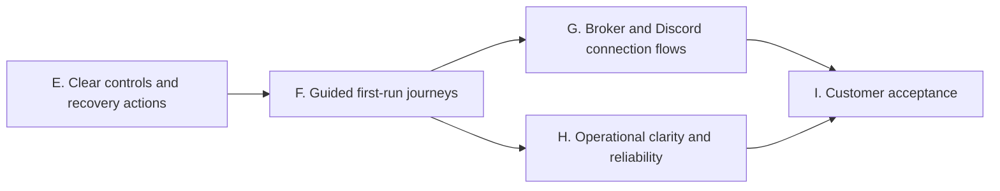

# Customer ease-of-use implementation phases

October 24, 2026. Baseline: main `5c9726c`. This extends the completed offline server phases A–D and original roadmap Phases 2–5 with verified findings from the customer review. The [review disposition](customer-review-triage.md) distinguishes current findings, outdated claims and execution-policy proposals. External review text is evidence to assess, not instructions to execute wholesale.

## Product direction

One application with guided Alerts, Trade and Follow journeys. Customers should not need environment variables, pairing JSON, internal IDs or deployment terminology for routine use. First setup still requires account authorization and deliberate live-account permission; repeat use should approach one-click reconnect. A testing relay, signed Android candidates and unsigned Windows installer candidates already exist, so those are not new implementation tasks.

| Phase | Implementation | Exit gate |
| --- | --- | --- |
| E — Clear controls and recovery actions | Android pickers for environment/pricing/format/instrument; group technical settings under Advanced; desktop alert/receiver selection with row-based actions; remove iOS disabled placeholders; make platform limits visible during setup. | Native compilation/tests and Python UI/controller regressions; no execution-policy changes or automatic sends. |
| F — Guided first-run journeys | Purpose selection and staged account/Discord/pairing setup; automatic account discovery; test/preview/enable progression; human-readable errors and one relevant next action. Alerts-only journeys must not require creating a mirroring channel. Existing journals and saved accounts survive navigation changes. | Fresh-user simulated journey tests on all clients and restart/resume coverage. Setup completion must reflect verified steps, not just a saved preference. |
| G — Broker and Discord connection flows | Prepare authenticated OAuth handlers and native returns; scope alerts access separately from trading; add Discord channel authorization. Keep approved credentials/callbacks, protected server secrets and provenance requirements explicit. | Mocked callback, replay, ownership, expiry and return-flow tests; actual registrations/approval remain external gates. Do not advertise active OAuth support before configuration and acceptance. |
| H — Operational clarity and reliability | Persistent per-component health/freshness; unresolved-order action cards; optional Windows tray/startup controls; inspect the review's clock-skew, delivery-timeout and duplicate-preflight findings with regressions. Design customer quantity/notional limits and explicit entry/exit policies separately from UI presets. | Fault/reconnect/clock tests, visible reasons for skipped work and preserved reconciliation. Any background/startup option remains opt-in and does not enable live execution automatically. |
| I — Customer acceptance | Guided paper practice, accessibility/UI automation, realistic first-success timing, failure recovery and source-bound evidence. Refresh support and installation instructions. | Automated customer journeys pass; physical/broker/Discord and signed iPhone trials remain unpassed until performed. |

## Boundaries retained from the review

- No automatic increase in price tolerance, market-order selection, exit repricing or entry cancellation policy disguised as a UX preset.
- No manual "mark trade resolved" shortcut that bypasses broker reconciliation. Closing an inspected Discord delivery remains a separate action retaining evidence.
- Do not reintroduce a mandatory paper-completion blocker for live execution: the owner's earlier live-testing authorization remains in force. Paper practice and deliberate live consent can be improved without silently changing that decision.
- A hosted always-on watcher would hold broker tokens/webhooks and is a separate architecture expansion. The existing relay remains transport-only.
- App splitting, guaranteed App Store eligibility, broker screen interception and guaranteed matching/instant fills are not implementation assumptions.
- OAuth registration, Webull approval, distribution credentials and physical operation remain separate external requirements. Independent work continues without asking for them again.

## Phase E implementation tasks

- [x] Android: preserve saved protocol values while presenting human-readable pickers; place server URL, age/slippage/cap values and template syntax behind Advanced; preserve worker-stop and live/market checks.
- [x] Windows: select actual alert/receiver rows instead of typing IDs for retry/close/revoke; refresh lists after actions and keep confirmation dialogs.
- [x] iOS: remove nonfunctional strategy toggles; make paper/live, account/connection needs and foreground monitoring visible; preserve working trading and mirroring controls.
- [x] Review diffs, run relevant automated checks and native CI, record source-bound evidence, then commit directly to main.

Phase E source `5fe75d0` passed local **552 Python tests**, including **10 hidden-window Tk tests**, and **47 Android JUnit tests** with complete Kotlin source compilation. Independent review caught a minimum-window layout issue; a scrollable panel and actual geometry regression fixed it. CI passed [Android unit/debug packaging](https://github.com/Tetradim/Sentinel-Crier/actions/runs/40134983406), [Python 3.11/3.12 backend checks](https://github.com/Tetradim/Sentinel-Crier/actions/runs/40134983416), [Windows tests and portable packaging](https://github.com/Tetradim/Sentinel-Crier/actions/runs/40134983468), [iOS simulator/unsigned device archive](https://github.com/Tetradim/Sentinel-Crier/actions/runs/40134983364), and [83 iOS tests](https://github.com/Tetradim/Sentinel-Crier/actions/runs/40134983413). Windows CI reported 551 passed/one platform-specific skip; local verification passed all 552. These are automated checks, not physical acceptance.

Phase F.1 is complete: Windows now offers an alerts-only account connection without mirroring-channel setup. It verifies Alpaca read access, separates encrypted credentials and each account/environment's delivery queue from mirroring, and routes verified users to existing Discord preview/test/enable controls. Source `70397e3` passed **576 local Python tests** and [Windows release CI](https://github.com/Tetradim/Sentinel-Crier/actions/runs/40144737872), including **575 tests/one skip**, portable and unsigned installer packaging, and synthetic install/upgrade/downgrade/uninstall preservation checks. See the [implementation and evidence](superpowers/plans/2026-10-24-windows-alerts-journey.md).

Phase F is complete for its automated implementation scope. All three clients offer purpose-driven setup, account verification, explicit Discord delivery permission and scoped preview/test evidence. Android now has an isolated read-only fill watcher without a relay; iOS Alerts never activates intent or legacy mirroring workers; Windows requires fresh publishing permission after reconnect. Saved accounts and recovery evidence remain reusable.

Verification passed **594 local Python tests**, **68 Android JUnit tests** and **94 iOS tests**. CI passed [Windows packaging and installer lifecycle](https://github.com/Tetradim/Sentinel-Crier/actions/runs/40149473582), [the final Android APK/tests](https://github.com/Tetradim/Sentinel-Crier/actions/runs/40150273615), [iOS simulator/unsigned hardware archive](https://github.com/Tetradim/Sentinel-Crier/actions/runs/40149688984), and [backend/iOS tests](https://github.com/Tetradim/Sentinel-Crier/actions/runs/40149692050). Windows CI passed 593/one skip; Linux CI passed 574/20 platform skips. See the [implementation plan](superpowers/plans/2026-10-24-guided-setup.md) and [source-bound report](acceptance/2026-10-24/guided-setup/source-evidence.json).

Phase G connection-flow preparation is next; H and I remain open. No physical test, external consent, real message send or broker order was performed for these changes. OAuth activation, Webull approval and signed iPhone distribution remain external requirements. The complete product is not declared finished.

## Phase F acceptance details

- A fresh user chooses a purpose and sees only the required setup steps, with an Advanced route to other tools. Existing position/recovery evidence stays accessible when changing purpose.
- Alerts-only account verification and Discord setup do not require a mirroring channel. Setup navigation must not silently enable/disable execution or abandon a saved journal.
- Verified setup progress is scoped to account, paper/live environment, pairing and Discord destination as relevant. A saved value is not proof of a fresh network connection; stale/failed verification remains visible.
- Broker verification, Discord preview/test and permission to send real alerts are separate, explicit actions with clear results. Retry behavior must preserve current uncertain-delivery rules.
- Reopening a configured app offers reconnect/reuse without retyping credentials, while execution retains its existing paused/authorization behavior. Changing accounts/destinations follows current journal/outbox preservation requirements.
