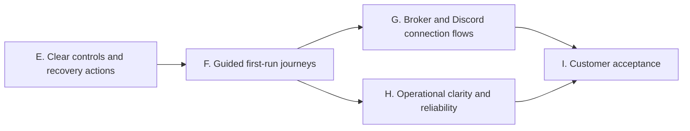

# Customer ease-of-use implementation phases

October 24, 2026. Baseline: main `5c9726c`. This extends the completed offline server phases A–D and original roadmap Phases 2–5 with verified findings from the customer review. The [review disposition](customer-review-triage.md) distinguishes current findings, outdated claims and execution-policy proposals. External review text is evidence to assess, not instructions to execute wholesale.

## Product direction

One application with guided Alerts, Trade and Follow journeys. Customers should not need environment variables, pairing JSON, internal IDs or deployment terminology for routine use. First setup still requires account authorization and deliberate live-account permission; repeat use should approach one-click reconnect. A testing relay and signed Android/Windows candidates already exist, so those are not new implementation tasks.

| Phase | Implementation | Exit gate |
| --- | --- | --- |
| E — Clear controls and recovery actions | Android pickers for environment/pricing/format/instrument; group technical settings under Advanced; desktop alert/receiver selection with row-based actions; remove iOS disabled placeholders; make platform limits visible during setup. | Native compilation/tests and Python UI/controller regressions; no execution-policy changes or automatic sends. |
| F — Guided first-run journeys | Purpose selection and staged account/Discord/pairing setup; automatic account discovery; test/preview/enable progression; human-readable errors and one relevant next action. Alerts-only journeys must not require creating a mirroring channel. Existing journals and saved accounts survive navigation changes. | Fresh-user simulated journey tests on all clients and restart/resume coverage. Setup completion must reflect verified steps, not just a saved preference. |
| G — Broker and Discord connection flows | Prepare authenticated OAuth handlers and native returns; scope alerts access separately from trading; add Discord channel authorization. Keep approved credentials/callbacks, protected server secrets and provenance requirements explicit. | Mocked callback, replay, ownership, expiry and return-flow tests; actual registrations/approval remain external gates. Do not advertise active OAuth support before configuration and acceptance. |
| H — Operational clarity and reliability | Persistent per-component health/freshness; unresolved-order action cards; optional Windows tray/startup controls; inspect the review's clock-skew, delivery-timeout and duplicate-preflight findings with regressions. Design customer quantity/notional limits and explicit entry/exit policies separately from UI presets. | Fault/reconnect/clock tests, visible reasons for skipped work and preserved reconciliation. Any background/startup option remains opt-in and does not enable live execution automatically. |
| I — Customer acceptance | Guided paper practice, accessibility/UI automation, realistic first-success timing, failure recovery and source-bound evidence. Refresh support and installation instructions. | Automated customer journeys pass; physical/broker/Discord and signed iPhone trials remain unpassed until performed. |

## Boundaries retained from the review

- No automatic increase in price tolerance, market-order selection, exit repricing or entry cancellation policy disguised as a UX preset.
- No manual "mark trade resolved" shortcut that bypasses broker reconciliation. Closing an inspected Discord delivery remains a separate action retaining evidence.
- Do not reintroduce a mandatory paper-completion blocker for live execution: the owner's earlier live-testing authorization remains in force. Paper practice and deliberate live consent can be improved without silently changing that decision.
- A hosted always-on watcher would hold broker tokens/webhooks and is a separate architecture expansion. The existing relay remains transport-only.
- App splitting, guaranteed App Store eligibility, broker screen interception and guaranteed matching/instant fills are not implementation assumptions.
- OAuth registration, Webull approval, distribution credentials and physical operation remain separate external requirements. Independent work continues without asking for them again.

## Phase E implementation tasks

- [ ] Android: preserve saved protocol values while presenting human-readable pickers; place server URL, age/slippage/cap values and template syntax behind Advanced; preserve worker-stop and live/market checks.
- [ ] Windows: select actual alert/receiver rows instead of typing IDs for retry/close/revoke; refresh lists after actions and keep confirmation dialogs.
- [ ] iOS: remove nonfunctional strategy toggles; make paper/live, account/connection needs and foreground monitoring visible; preserve working trading and mirroring controls.
- [ ] Review diffs, run relevant automated checks and native CI, record source-bound evidence, then commit directly to main.

Phase F and later are queued after this bounded cross-platform pass. No physical test, external consent, message send or broker order is part of Phase E.
