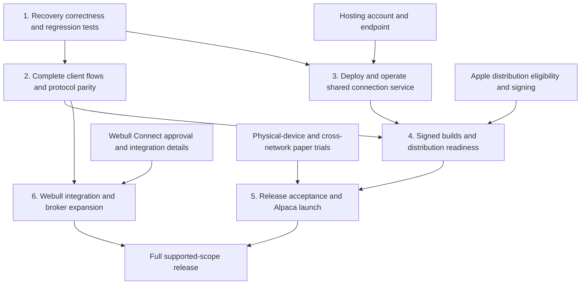

# Sentinel Crier completion roadmap

Updated October 24, 2026. Original planning baseline: main `9d33f4a`. The phase definitions below retain their original acceptance requirements; the current status section records subsequent implementation and external blockers.

For the remaining work executable without owner input, follow the [autonomous implementation plan](autonomous-completion-plan.md). It schedules atomic authorization, server coordination, operational recovery and automated acceptance. External release requirements remain tracked here and are excluded from that implementation queue.

## Goal and architecture

Ship an installable iOS, Android, and Windows product that publishes customizable Discord alerts and mirrors enter/replace/cancel/exit instructions placed inside Crier. Each receiver uses its own account, pricing settings, and durable execution journal. The HTTPS relay transports instructions; broker execution stays on each device. Python/SQLite, SwiftUI, and Kotlin implementations share the same protocol and must pass the same lifecycle scenarios.

The first release is Alpaca stocks and standard long single-leg options. Webull Connect is a separate, required expansion of the original project scope, contingent on approved access. Neither release promises identical fill prices or continuous execution by a suspended phone. Screen recognition is observation evidence, not an authoritative broker order-submission feed.

## Phase graph

External dependencies may be resolved while coding proceeds. Phase 5 includes physical testing explicitly; completing the other phases does not establish real-device or live-broker correctness.

## Current evidence and remaining gaps

Already implemented: durable execution timeline, sender/receiver tracking, reconciliation evidence, automatic near-event premium observations, clock-adjusted cross-device timing with uncertainty, diagnostics screens, and JSON/CSV export. Existing automated builds exercise backend, Windows packaging, Android, and iOS simulator code. These are not proof of customer installation or broker execution accuracy.

Recovery fixes, native setup/Discord flows and invalid-event handling have automated evidence in [Phase 2 progress](phase2-progress.md). The Supabase HTTPS relay is deployed and bundled in all clients; its SQL, Edge gateway and isolated hosted transport checks are recorded in [test results](test-results-2026-10-23.md). Relay transport uses bounded HTTP polling, not Realtime push. Broker credentials stay on the executing devices.

Signed Android APK/AAB and an unsigned Windows installer/portable ZIP have been produced; see [candidate release evidence](release-evidence-2026-10-23.md). iOS simulator builds and unsigned Release hardware archive checks pass. The Android identity has a password-protected tablet backup with verified read-back hashes. Apple Developer enrollment, real signing inputs, distribution eligibility and finalized privacy/contact metadata are still required for iPhone distribution. A Windows publisher certificate remains optional and absent. See the [October 24 Phase 4 status](phase4-status.md) for completed work and remaining gates.

Physical-device, cross-network and broker paper-accuracy acceptance is deferred by the owner, not passed. Webull Connect approval is still pending. Its local authorization-session groundwork does not implement working broker login or trading. These external gates prevent claiming the whole project is finished.

The owner has now closed Phase 4 implementation with explicit deferrals of Apple enrollment/signing and all owner/external-dependent Phase 4 work, authorizing Phase 5 automated acceptance. See [Phase 4 deferrals](phase4-status.md) and [Phase 5 evidence](phase5-results-2026-10-24.md). This progression does not waive the original distribution or real-device acceptance requirements before claiming a supported release.

## Phase 1 — recovery correctness (execute now)

Changes: `crier/intent_engine.py`, Android `Engine.kt`, iOS `IntentMirroring.swift`, and corresponding regression tests.

- Persist cancellation attempt time before sending a cancellation request.
- Reconcile a fresh, identity-validated broker order before every retry. Unknown lookups must not authorize another request.
- Suppress retries for terminal orders and `pending_cancel`. Retry active orders after at least five seconds, including after restart or a lost response.
- Recover older journals whose cancellation marker has no timestamp.
- Keep uncertain order submissions blocked from blind reposting.
- Defer future-created instructions without permanently marking them completed/skipped; preserve fractional timestamp comparisons.
- Test cancellation/fill races, position-bounded exits, account/order identity, unknown lookups, restart, and timing boundaries.

Exit gate: targeted regressions and complete Python suite pass; native compile/tests pass in CI; no broker connections or live orders are used by these checks. A physical cancellation/reconnect trial remains part of Phase 5.

## Phase 2 — finish the customer flows and protocol parity

1. Bring Android Host/Receive setup to the invitation-based flow used by other clients; remove manual JSON as the normal customer path.
2. Provide consistent Discord destination setup, card/plain-text preview, templates, field selection, test-message action, and delivery/retry status across platforms. Preserve explicit distinctions between intent, manual observation, and broker fill.
3. Expose receiver revocation, reconnect status, unresolved orders, safe account/channel changes, credential rotation, and journal-preserving recovery.
4. Add shared protocol fixtures for malformed events, conflicting revisions, definitive HTTP rejections, authentication failures, and restart while an instruction is pending. A bad event must not silently stop the entire channel.
5. Make background/suspended/paused status visible. Handle Android service timeout and foreground resume; reconcile before resuming new work. Push notifications may aid awareness, but must not be advertised as guaranteed execution wakeups.
6. Exercise stock and option symbols, contracts, quantity, decimal premium, partial fills, cancel/replace races, and unrelated holdings through each implementation. Add settings migration and compatibility tests.

Exit gate: a fresh user can connect an account, host/join, configure alerts, see execution status, recover a disconnect, and revoke a receiver without editing files. All supported clients pass identical lifecycle fixtures.

## Phase 3 — make remote connections operational

1. Provision an actual HTTPS endpoint and configure it in released apps. Hosting provider/account selection is an owner dependency; this plan does not create paid services.
2. Deploy the existing relay with persistent storage and one worker while SQLite is used. Validate authentication, invitation expiry, revocation, rate limits, replay protections, and device isolation.
3. Automate consistent database backups, retention, restore verification, health checks, and operational notifications; document recovery and rollback.
4. Run synthetic concurrency/reconnect tests at a declared customer capacity. Record delivery latency percentiles, queue age, failures, and recovery after restart. Separate transport timing from broker acknowledgement and fill timing.
5. Document maintenance interruption behavior. Move to a multi-instance database architecture only if measured capacity/availability requirements demand it.

Exit gate: two remote clients can discover the configured service; restart/restore retains channels and journals; measured capacity and latency are published. A provisioned service and its operational owner are required.

## Phase 4 — release and distribution

1. Resolve Apple distribution eligibility for a trading/mirroring app before assuming public App Store approval. Establish the developer identity, signing, provisioning, privacy disclosures, support contact, and review explanation.
2. Produce signed iPhone device builds and a TestFlight testing route; signed Android release packages; a versioned Windows installer/update route with publisher signing where available.
3. Preserve credentials, journal identity, and schema migrations across upgrades. Verify rollback behavior without losing unresolved orders.
4. Publish supported brokers/assets, foreground/background behavior, alert provenance, installation instructions, recovery instructions, and known limitations. Do not label unvalidated brokerage adapters as supported.

Exit gate: reproducible release artifacts, provenance/checksums, distribution credentials, upgrade tests, and store/distribution requirements are satisfied. Approval cannot be guaranteed by compilation.

## Phase 5 — release acceptance

Run `docs/intent-paper-acceptance.md` on real iPhone/Android/Windows devices across separate networks with authorized paper accounts. Compare contract, side, quantity, price, fills, cancellations, and positions against brokerage UI and authoritative records. Exercise lock/background, service timeout, network switching, force quit, restart, latency/slippage, and Discord outage recovery. Set measurable pass/fail limits before testing and retain redacted evidence.

Exit gate: all supported platform combinations pass; unresolved mismatches are fixed; customer-visible latency is reported honestly; signed artifacts match the tested commit. Any live-account validation requires explicit scope and authorization separately.

## Phase 6 — Webull and additional brokerage support

October 24 update: the owner approved the implementation plan and confirmed that Webull's response is still pending. The isolated [authorization and custody groundwork](webull-connect.md) now includes form/response validation, cryptographically random browser-state material, an AES-GCM token vault and candidate durable PostgreSQL session/token stores. Refresh claims use monotonic generations and operation fences; uncertain rotating-token refreshes require new authorization, and local revocation prevents late results from restoring credentials. These schemas remain outside deployment migrations and are not deployed or connected to a client. Customer authentication, integrated signed exchange/refresh orchestration, approved native redirects and the Connect trading adapter remain unimplemented. See the linked status document for current test evidence. This does not satisfy the Phase 6 exit gate.

1. Use the already-submitted Connect application; obtain approved scopes, redirect URI, sandbox access, order-event capabilities, and permitted market-data use. Do not submit a duplicate application.
2. Confirm Webull's approved native-client architecture. Its documented OAuth flow includes server-held application secrets; never embed these in the open-source mobile binaries. A token-exchange service may expand the current relay's responsibilities and needs separate isolation and credential handling.
3. Implement authorization, refresh/revocation, order placement, order-event monitoring, cancellation, positions, and reconciliation using Connect-specific contracts. Do not assume Trading API and Connect API are interchangeable.
4. Repeat the same lifecycle and paper acceptance suite before advertising Webull support. Broker-app orders can only be mirrored at the earliest event that the approved integration actually exposes.
5. Assess each further broker against documented APIs and permissions. Generic background observation of arbitrary iOS brokerage screens remains a feasibility boundary, not an unchecked implementation task.

Exit gate: approved access, tested adapter, customer authorization/revocation flow, and broker-specific evidence. Full original Webull scope remains incomplete until this gate passes.

## Research that affects implementation

- [Alpaca order lifecycle](https://docs.alpaca.markets/us/docs/orders-at-alpaca): client order IDs support lookup and streaming order updates. Pending cancellation is an intermediate state; the engine must reconcile the final outcome rather than assume a successful request removed an order.
- [Apple background networking guidance](https://developer.apple.com/forums/thread/799259): low-level networking stops when an iOS app is suspended. A persistent socket or visual overlay is not a general background-execution entitlement. This limits unattended phone execution.
- [Android foreground-service timeouts](https://developer.android.com/develop/background-work/services/fgs/timeout): Android 15+ restricts background `dataSync` foreground services to six hours in a 24-hour period and requires timeout handling. Foreground-service operation alone does not establish an all-day guarantee.
- [Apple review guideline 3.2.1(viii)](https://developer.apple.com/app-store/review/guidelines/): trading apps face financial-institution submission and permission requirements. Resolve applicability with Apple and the broker; code signing alone is insufficient for public release.
- [Webull OAuth integration](https://developer.webull.com/apis/docs/connect-api/authentication/): approval supplies application credentials, with secrets intended for protected server-side handling. Native distribution must not disclose them.
- [Render persistent disks](https://render.com/docs/disks) and [deployment behavior](https://render.com/docs/deploys): persistent-disk deployment has availability constraints. Recovery and maintenance behavior must be tested and documented for the selected hosting configuration.

## Completion rule

Call the Alpaca release complete only after Phases 1–5 pass with retained evidence. Call the full Webull-inclusive product complete only after Phase 6 also passes. Optional future brokers do not silently expand the release promise. Track unresolved defects and external dependencies separately from implemented features.
